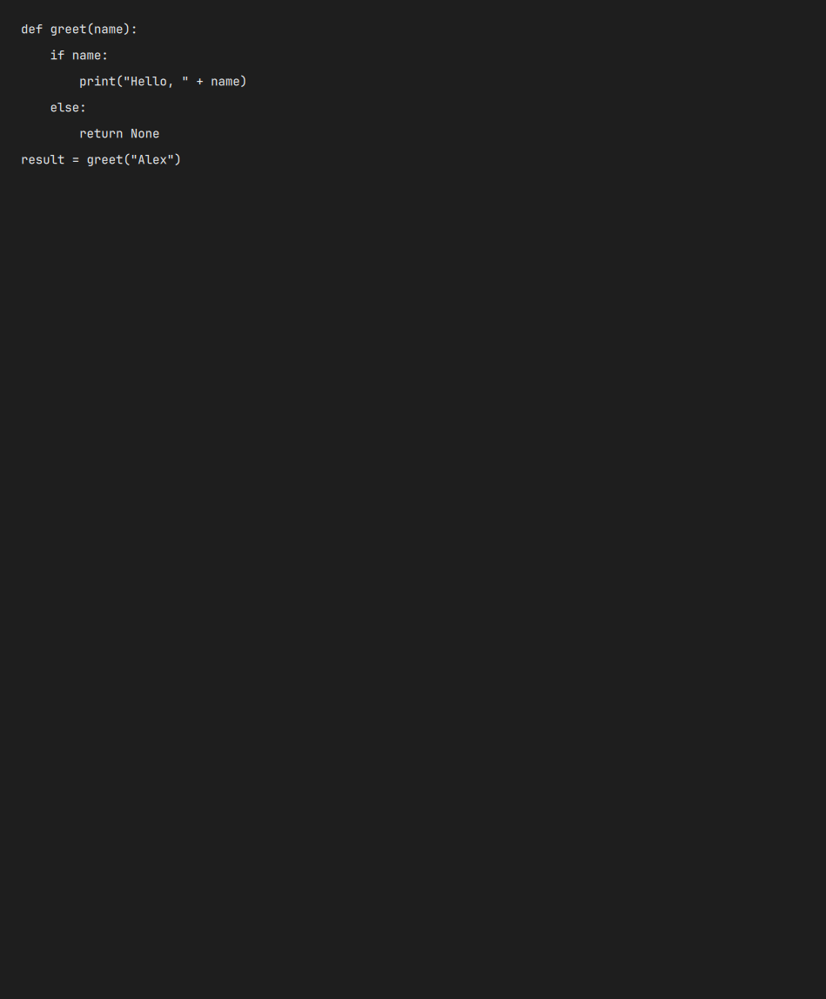

# Screen OCR

I think this is a godsend when I'm developing. I can just select text on my screen and copy paste it quickly instead of typing it all out.



This is one of the synthetic screenshots used to test recognition. Screen OCR runs locally and copies the recognised text to your clipboard.

**Supported platform: Arch Linux + Hyprland only.** Other distributions, compositors and operating systems are outside this repo's supported setup. The end-4 integration additionally needs its matching QuickShell ii / Lua Hyprland configuration.

## What is included

- Standalone region selection with slurp + grim, or OCR from an existing image.
- Clipboard output by default, with plain-text stdout and JSON modes for scripts.
- PP-OCRv5 mobile detector (`ch_PP-OCRv5_det_mobile`) and English mobile recognizer (`en_PP-OCRv5_rec_mobile`), using RapidOCR 3.10.0 and CPU ONNX Runtime 1.31.1.
- Pinned Python dependencies and verified local model downloads. Captures run offline after setup; no hosted OCR service or API key.
- Optional checked end-4 integration using the existing region selector and Super+Shift+X.

The models load for each capture and the OCR process exits afterward. There is no OCR daemon. A normal Wayland clipboard-owner process can remain after copying.

## Setup

Run setup as your regular desktop user. You need `uv`, Python 3 for the launcher/setup script, a Wayland session, `wl-copy` and `notify-send`. Region selection also needs `slurp` and `grim`. On Arch, install missing desktop dependencies with:

```bash
sudo pacman -S --needed uv wl-clipboard libnotify slurp grim
```

Clone the repo, then create its isolated Python 3.12 environment and download the pinned models:

```bash
git clone https://github.com/wrestle-R/screen-ocr.git
cd screen-ocr
python3 setup.py
```

`uv` can obtain Python 3.12 if needed. Dependencies/models live under `~/.local/share/rdp-screen-ocr/`, separate from system Python. Setup requires internet access; ordinary recognition uses the downloaded local models. This snapshot uses that default data directory for runtime and setup.

## Use it standalone

Select a screen region and copy recognized text:

```bash
./screen-ocr --select
```

Read an image without changing the clipboard:

```bash
./screen-ocr --image /path/to/image.png --stdout
./screen-ocr --image /path/to/image.png --json
```

Crop coordinates are X, Y, width and height in source-image pixels:

```bash
./screen-ocr --image /path/to/image.png --crop 20 30 800 400 --stdout
```

With no output flag, successful nonempty recognition replaces the clipboard. Cancellation, recognition failure and empty text leave it alone. `--delete-input` removes an explicitly disposable input; omit it for images you want to keep.

To make a convenient launcher, first check that `~/.local/bin/screen-ocr` does not already exist, then:

```bash
mkdir -p "$HOME/.local/bin"
ln -s "$PWD/screen-ocr" "$HOME/.local/bin/screen-ocr"
```

Keep the cloned repo at that path. Add `~/.local/bin` to your shell's PATH if it is not already there. No environment file is required.

## Desktop integration

[DESKTOP.md](DESKTOP.md) covers a custom Hyprland shortcut and the guarded QuickShell ii/end-4 installation, including conflicts, backups and rollback. Standalone use does not need the end-4 installer.

## Checks

```bash
python3 -B test_ocr.py
```

These regression tests use temporary configs and mocked OCR/clipboard calls. They cover reading order, indentation, blank lines, input cleanup, clipboard preservation, install/restore and rollback. They do not prove real recognition accuracy or desktop shortcut behaviour.

[Historical benchmark](BENCHMARK.md) includes synthetic fixtures, measured latency and known recognition errors from the original machine. It is not a guarantee for other hardware. The benchmark writes its own fixture/results files and requires the pinned environment, ImageMagick, Tesseract and the documented fonts; run it deliberately.

## Limits

English recognition only. Small text, low contrast, code punctuation, columns and tables can still be wrong; spacing is estimated from geometry. Check extracted commands before running them. Images larger than 25 megapixels are rejected; select a smaller region. Model files total about 12.1 MiB and the original isolated environment used about 350 MiB.

## Source and license

Extracted from [my Linux setup](https://github.com/wrestle-R/Linux/tree/e9baeebf24fa0917f94c9394ef3f3fcef29e7f31/End-4/ocr). `SOURCE.json` records the commit and original file hashes. Integration snapshots include code from [end-4/dots-hyprland](https://github.com/end-4/dots-hyprland); the GPLv3 license is preserved in [LICENSE](LICENSE). Runtime dependencies and downloaded models retain their own upstream licenses and are not bundled here.

Checked-in screenshots are synthetic text fixtures. Personal screenshots, clipboard contents, credentials, local backups and private project notes are excluded.
