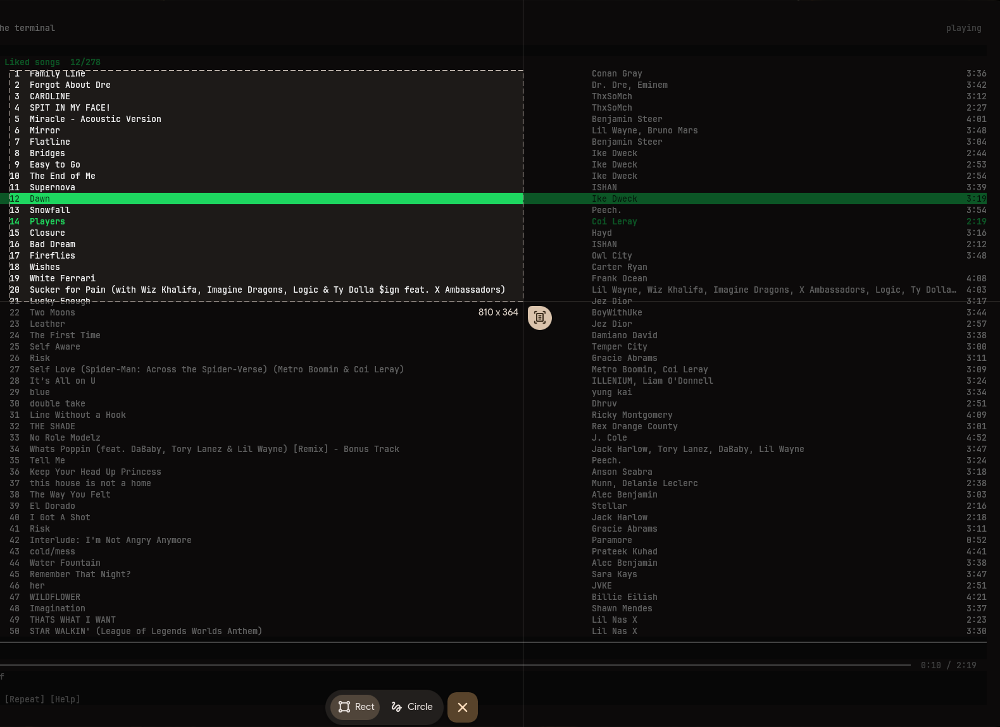

# Screen OCR

**Arch Linux + Hyprland only.** I think this is a godsend when I'm developing, I can just select text on my screen and copy paste it quickly instead of typing it all out.



Select the text and it copies to your clipboard. It runs locally using PP-OCRv5 mobile detection and English recognition models.

## Install

Install the dependencies, then clone and set it up:

```bash
sudo pacman -S --needed uv wl-clipboard libnotify slurp grim
git clone https://github.com/wrestle-R/screen-ocr.git
cd screen-ocr
python3 setup.py
```

Run `./screen-ocr --select` to select text. For the end-4 sidebar and **Super+Shift+X**, see [desktop integration](DESKTOP.md).

[More usage and setup details](GUIDE.md) · [License](LICENSE)
